# Sistem Informasi Antrean Puskesmas Purwokerto - Backend dan Frontend

Backend REST API untuk aplikasi Sistem Informasi Antrean dan Pelayanan Puskesmas Purwokerto yang dibangun menggunakan **NestJS** dengan struktur **MVC** dan penyimpanan data sementara (*in-memory array*). Terhubung langsung dengan frontend React + Vite.

Dibuat untuk memenuhi **Tugas 9 PPW: NestJS Dasar + Struktur MVC**.

---

## Deskripsi Proyek

Aplikasi ini mengelola data utama berupa entitas **Pasien** (`Patient`) untuk kebutuhan pendaftaran antrean baru, pemantauan status pemeriksaan pasien secara langsung, serta manajemen antrean oleh petugas medis (memanggil pasien, menyelesaikan pemeriksaan, dan menghapus data antrean).

---

## Endpoint API

Base URL: `http://localhost:3000/patients`

| Method | Endpoint | Keterangan |
|---|---|---|
| `GET` | `/patients` | Menampilkan seluruh data antrean pasien |
| `GET` | `/patients/:id` | Menampilkan detail pasien berdasarkan ID antrean |
| `POST` | `/patients` | Mendaftarkan pasien baru (validasi DTO dan cek duplikasi NIK) |
| `PATCH` | `/patients/:id` | Mengubah data atau status pemeriksaan pasien berdasarkan ID |
| `DELETE` | `/patients/:id` | Menghapus data pasien berdasarkan ID |
| `POST` | `/patients/reset` | Memulihkan data contoh awal pasien |
| `DELETE` | `/patients/clear/all` | Mengosongkan seluruh data antrean sementara |

---

## Fitur Implementasi Backend

1. **Entity (`Patient`)**: Merepresentasikan struktur data pasien dengan field `id`, `nomorAntrean`, `nama`, `nik`, `email`, `telepon`, `alamat`, `jenisKelamin`, `tanggalLahir`, `poli`, `keluhan`, `waktuDaftar`, `status`, `aktif`, dan `createdAt`.
2. **Service (`PatientsService`)**: Mengimplementasikan operasi CRUD lengkap (`create`, `findAll`, `findOne`, `update`, `remove`) menggunakan *in-memory array*.
3. **Controller (`PatientsController`)**: Menyediakan seluruh HTTP method (`GET`, `POST`, `PATCH`, `DELETE`) dengan *dependency injection* ke `PatientsService`.
4. **DTO dan Validasi (`class-validator`)**: Menggunakan `CreatePatientDto` dan `UpdatePatientDto` serta `ValidationPipe` global pada `main.ts`.
5. **Exception Handling**: Menangani skenario error menggunakan `NotFoundException` (data tidak ditemukan), `ConflictException` (NIK duplikat pada antrean aktif), dan `BadRequestException` (validasi input atau transisi status tidak valid).

---

## Cara Menjalankan

### 1. Menjalankan Backend (NestJS)

```bash
cd backend
npm install
npm run start:dev
```
*Backend berjalan di port `3000`. Pengujian endpoint dapat menggunakan file `backend/requests.http`.*

### 2. Menjalankan Frontend (React + Vite)

```bash
cd frontend
npm install
npm run dev
```
*Frontend berjalan di port `5173` dan terhubung ke `http://localhost:3000/patients`.*

### 3. Mengakses Halaman Petugas (Dashboard Manajemen Antrean)

Aplikasi frontend menggunakan navigasi berbasis state pada alamat `http://localhost:5173`. Untuk membuka halaman petugas:

1. Buka `http://localhost:5173`, lalu gulir ke bagian paling bawah halaman (Footer) dan klik **Portal Petugas**.
2. Masuk menggunakan akun petugas berikut:
   - **Username**: `petugas`
   - **Kata Sandi**: `puskesmas123`
3. Setelah berhasil masuk, halaman **Manajemen Antrean** akan terbuka untuk mengelola status pemeriksaan pasien (`Panggil`, `Selesai`) dan menghapus data antrean.

---

## Dokumentasi Screenshot

Berikut adalah tangkapan layar implementasi kode dan pengujian yang tersimpan pada folder `docs/screenshots/`:

### 1. Patient Entity
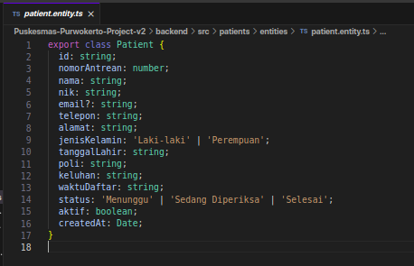

### 2. Patients Module
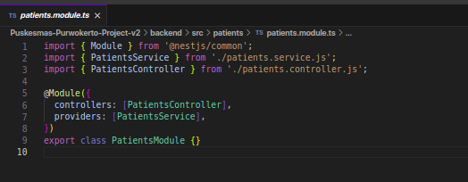

### 3. Patients Controller
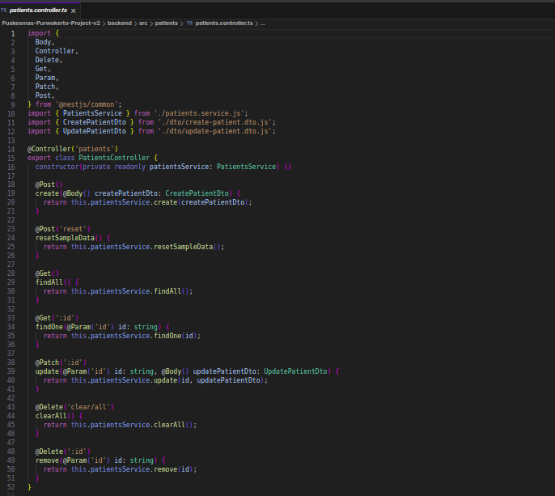

### 4. Patients Service (CRUD)
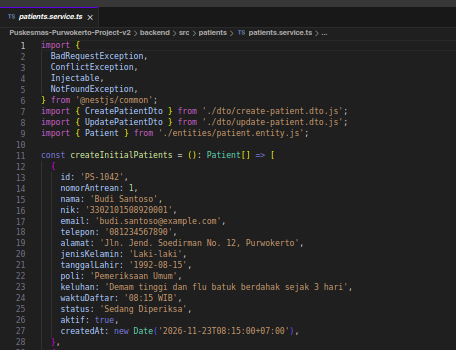

### 5. CreatePatientDto
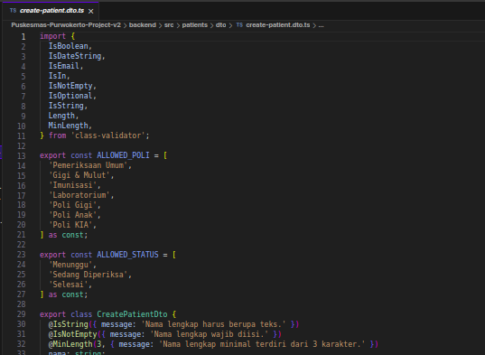

### 6. UpdatePatientDto
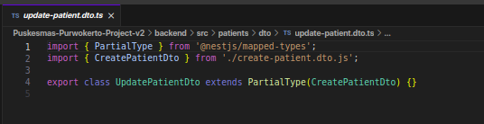

### 7. Global ValidationPipe dan CORS (main.ts)
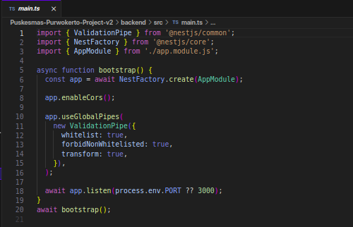

### 8. Exception Handling
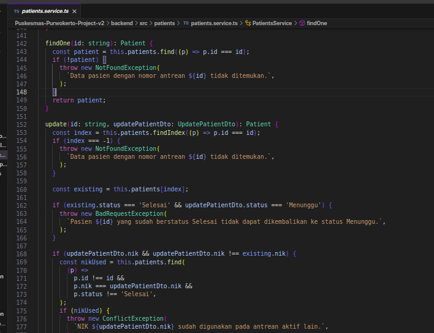

### 9. Pengujian REST Client

#### a. GET Seluruh Data Pasien
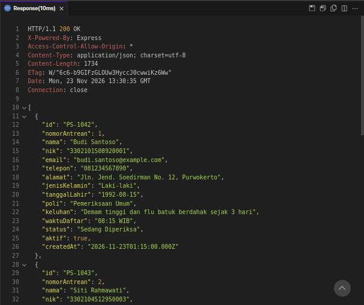

#### b. GET Data Pasien Berdasarkan ID
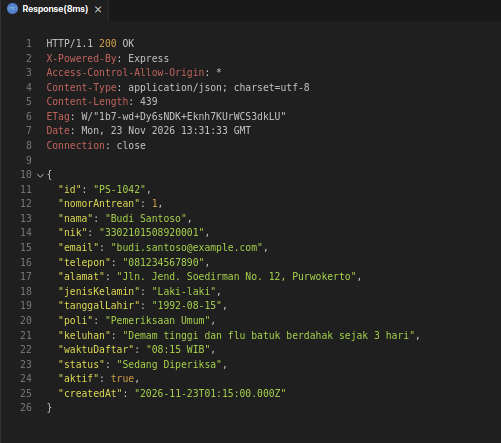

#### c. POST Tambah Data Pasien
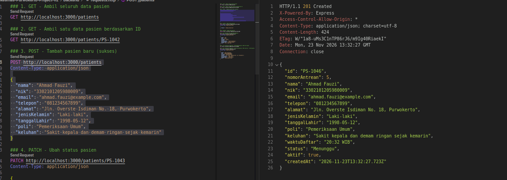

#### d. PATCH Ubah Status Pasien Berdasarkan ID
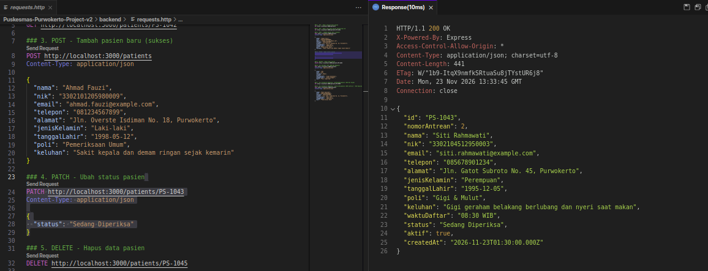

#### e. DELETE Hapus Data Pasien Berdasarkan ID
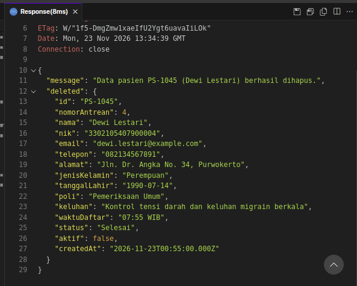

#### f. Uji Exception Handling (Validasi DTO dan NotFoundException)
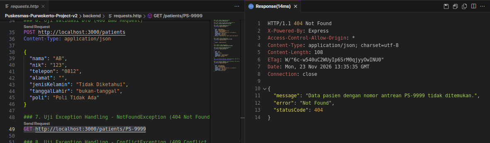

#### g. Uji Exception Handling (ConflictException - NIK Duplikat)
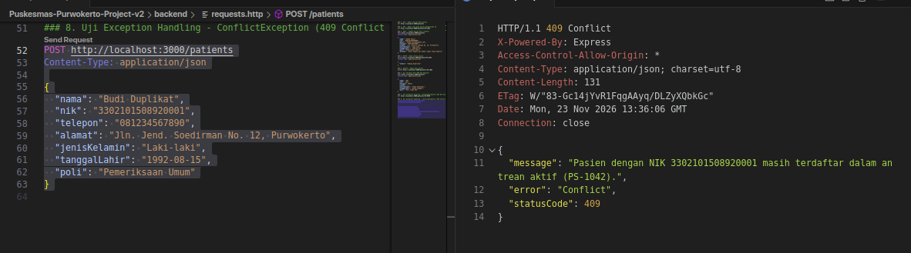
